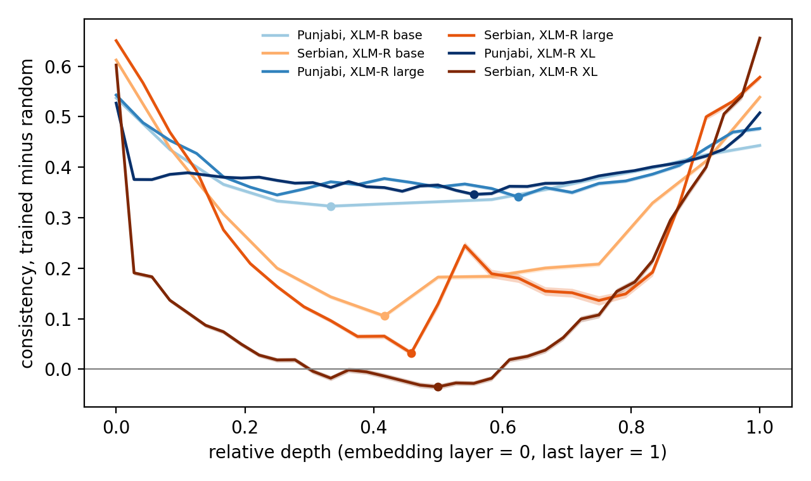

# One Language, Two Unequal Scripts: Separating Orthography from Information in Multilingual Representations with Punjabi

Code, result files and the findings log: github.com/roshaneyshah/mukhi.

## Abstract

Multilingual models are said to abstract away script in their middle layers. Tests usually compare languages that differ in script and language at once. Punjabi does not. It is written in Gurmukhi and
in Shahmukhi, which differ in what they record, since unvocalised Shahmukhi
leaves short vowels and gemination unwritten. In a public recreation of
XLM-R's training data, Shahmukhi Punjabi is about 1% as frequent as
Gurmukhi. We use this pair to separate script form from missing information in four encoders. Every statistic is compared with the
same architecture under random weights and bootstrapped over sentences. Four Gurmukhi
controls remove information in steps. The share of the gap they leave falls
at every step, and under these controls the two ends estimate it at 0.65 to 0.90. The pattern holds on human-written Shahmukhi. Across three XLM-R
sizes the Punjabi gap grows slightly, while the gap for Serbian Cyrillic and
Latin, whose Latin orthography is abundant as Croatian, shrinks and drops
below its random baseline in XL. This fits a role for script resource but
does not isolate it as the cause. Three mean-pooled decoders do not show this
ordering. Transliteration closes 45% of a cross-script gap in
topic-classification accuracy.

---

## 1 Introduction

A multilingual model that shares meaning across languages should not care
which script a sentence arrived in, at least past the first few layers.
Whether it does is usually tested on language pairs that also differ in
script, so the two effects cannot be told apart. Digraphic languages, written
in two scripts, hold language constant.

Two 2026 papers take this route and disagree. Karne (2026) finds that Gemma
sparse-autoencoder features for identical Serbian sentences in Cyrillic and
Latin overlap far above chance, increasingly so with scale. Verma et al. (2026)
find that romanising Hindi and other languages yields language-associated
units nearly disjoint from the native-script ones.

We argue part of the answer lies in the pair. Serbian Cyrillic and Latin are
*balanced* in everyday use. Both are common (Karne, 2026), and a lossless
one-to-one mapping relates them. Punjabi is a clear case of *unbalanced
digraphia*. Shahmukhi has more speakers than Gurmukhi: about 89 million
first-language speakers of Punjabi in Pakistan's 2023 census against 33
million in India's 2011 census (Pakistan Bureau of Statistics 2023, Office
of the Registrar General of India 2011). The two censuses are twelve years
apart and define language categories in their own ways. Online, Shahmukhi is
far rarer. We count both pairs in CC-100, a public recreation of XLM-R's training data (Section 3.6). Shahmukhi Punjabi has no section of its own
there, and inside the Urdu section it amounts to about 1% of the Gurmukhi
Punjabi section. Serbian's own section is 99% Cyrillic, yet its Latin
orthography is abundant as Croatian and Bosnian text, at four times the
volume of Serbian Cyrillic. Shahmukhi has no such close neighbour. The
abundant text in its script is Urdu, a different language. Shahmukhi also
records less. It is a Perso-Arabic script with marks for short vowels and
gemination (zer, zabar, pesh and tashdid), and as in ordinary Urdu and Arabic
writing those marks are left off. The Punjabi pair therefore differs both in information and in how much closely related text a model sees in each script. We call a pair balanced when both scripts are common in use and each has abundant closely related text in pretraining, and unbalanced when one does not.

This paper makes four contributions.

1. **A measurement that uses the pairing.** In a minimal pair, the content
   shared by a sentence's two renderings cancels in their difference. We
   define a paired displacement statistic on that difference and show on
   planted data that it is unmoved by content variance, whereas linear probe
   accuracy, the usual instrument, falls from 1.00 to 0.78 while the script
   signal is held exactly constant (Section 4.2).
2. **Graded information controls.** Deleting from Gurmukhi the marks
   unvocalised Shahmukhi leaves off keeps more information than Shahmukhi.
   Transliterating Shahmukhi back to Gurmukhi keeps at most what Shahmukhi
   records. Two controls between them merge the letters Shahmukhi does not
   distinguish. The share of the Punjabi gap attributable to script form falls
   at every step of this series, so it is reported as the interval between the
   two ends (Sections 3.3 and 5.3).
3. **Evidence that does not rest on one statistic,** with every effect
   reported against the same architecture with random weights (Section 4.4),
   on direction consistency and on two distance measures (Section 4.2), with
   sentence-level bootstrap tests of every comparison (Section 4.6), and
   against a balanced Serbian contrast run through the identical pipeline.
4. **A direct count of script resource** in a recreation of XLM-R's training data, for both
   pairs, with the classifiers behind it validated on FLORES (Section 3.6).

Throughout, we measure representational separation: how far apart and how
consistently a sentence's two renderings sit. Separation bears on script
invariance. It does not by itself show whether a model keeps the information
a task needs, which the intervention of Section 5.5 tests directly.

---

## 2 Related work

**Language neutrality of multilingual representations.** Pires et al. (2019)
and Wu and Dredze (2019) documented cross-lingual transfer in multilingual
BERT without shared vocabulary. Libovický et al. (2020) measured how
language-neutral its representations are. Conneau et al. (2020) scaled the
recipe in XLM-R. Kudugunta et al. (2019) observed that later encoder layers
of multilingual translation models reflect script less, with Serbian and
Croatian becoming near neighbours despite disjoint subwords. Neuron-level work
identifies language-associated units (Tang et al., 2024).

**Script as a variable.** Karne (2026) uses Serbian digraphia with SAE
features and finds script invariance. Verma et al. (2026) find
language-associated units conditioned on orthography, using romanisation
produced by a transliterator. Singh et al. (2026) introduce PuMVR, 1,000
parallel Punjabi items in Gurmukhi, Shahmukhi and Roman script, and find
vision-language models answer identical items differently by script. They
note the behavioural gap is consistent with data imbalance and tokeniser
confounds they cannot separate. We supply a representational analysis of the
same language with those confounds measured.

**Transliteration for transfer.** Transliterating related languages to a
common script helps low-resource transfer (Moosa et al., 2023) and Jayakumar et
al. (2026) survey the area. Our intervention asks a narrower question: for one
language in two scripts, how much of a script gap transliteration can close,
and whether what remains is information the source script lacks.

**Method.** We use centred kernel alignment (Kornblith et al., 2019) with the
unbiased HSIC estimator (Song et al., 2012), probes with control tasks
(Hewitt and Liang, 2019), and Benjamini-Hochberg control (Benjamini and
Hochberg, 1995). Tokeniser quality follows Rust et al. (2021).

---

## 3 Data

### 3.1 Parallel text

The main set is FLORES+ dev and devtest (NLLB Team, 2022), 2,009 sentences aligned by sentence
id across `pan_Guru`, `urd_Arab`, `hin_Deva` and `srp_Cyrl`. FLORES+ contains
no Shahmukhi and no Serbian Latin.

**Serbian Latin** is produced by the standard lossless Cyrillic-Latin mapping.

**Shahmukhi** is generated from the Gurmukhi. Gurmukhi-to-Shahmukhi is the
easy direction, since Gurmukhi writes every vowel Shahmukhi needs. We built a
rule system, selected its three ambiguous defaults by exhaustive search over
12 configurations on a development split of PuMVR word pairs
(`tools_g2s_grid.py`), and scored a held-out split once (Table 1). The
pretrained SLPG model (Shehzadi et al., 2024) is used instead only if it
scores a lower CER
on PuMVR in the same run. On this run the rules won and were used
throughout, at 5.6% held-out word CER, since the SLPG checkpoint's
preprocessing could not be verified (Finding 6). The Shahmukhi condition is
therefore machine-generated, which makes it more regular than natural
writing. The human-written PuMVR set (Section 3.4) is our robustness check.

**Table 1.** Transliteration quality against human PuMVR text. Word figures
are on 233 held-out unique word pairs and sentence figures on all 1,000 items.

| system | word CER | 95% CI | word exact | sentence CER |
|---|---:|---|---:|---:|
| Shahmukhi to Gurmukhi, naive map | 50.9% | [47.5, 54.1] | 9.0% | 38.4% |
| Shahmukhi to Gurmukhi, context rules | 16.0% | [14.1, 18.0] | 43.3% | 15.1% |
| Gurmukhi to Shahmukhi, rules | 5.6% | [3.8, 7.6] | 83.3% | 6.4% |

Development and held-out error agree to within half a point in both
directions (16.1% vs 16.0% and 5.2% vs 5.6%).

### 3.2 What unvocalised Shahmukhi leaves unwritten

Of the edits remaining after the best Shahmukhi-to-Gurmukhi rules, 38.7% are
insertions of sihari (ਿ), aunkar (ੁ) or addak (ੱ): short vowels and gemination
the Shahmukhi input does not contain. The rest is dominated by letters whose
Gurmukhi value is genuinely ambiguous (ن as ਨ or ਣ, و as ੋ ੂ or ੌ and medial ی as
ੀ, ੇ or ੈ). An exhaustive search over the five ambiguous defaults of those
rules, 162 configurations, moved error only between 16.1% and 19.5%. The
Punjabi pair therefore differs in information, and the Serbian pair does not.

### 3.3 Conditions and contrasts

Every condition is aligned to the same sentences. Removing sihari, aunkar and
addak from Gurmukhi gives **de-voweled Gurmukhi**, an approximately
information-matched control: 6.8% of Gurmukhi characters are removed on
FLORES+ and 6.6% on SIB-200, and the character error rate of
rule-transliterated Shahmukhi against it falls from 15.0% to 10.2% on
FLORES+ (15.1% to 10.3% on SIB-200). What remains is ambiguous letter
choice. Both figures are computed by
`tools_devowel_check.py` on the same NFC-normalised condition files the
experiments use, and recorded in `results/devowel_check.json`.

De-voweled Gurmukhi keeps more information than Shahmukhi, since it still
records every ambiguous letter choice Shahmukhi collapses. A second control
approaches information matching from the other side: **round-tripped
Gurmukhi**, Shahmukhi transliterated back to Gurmukhi by the rules of 3.2,
records at most what Shahmukhi records, plus the rules' own errors. An
information-matched Gurmukhi lies between the two. Two further controls fill
the gap without passing through the transliterator. Each starts from
de-voweled Gurmukhi. **Level 1** also writes ਣ as ਨ, since Shahmukhi has one
letter for both. **Level 2** also merges the vowel signs Shahmukhi writes with
one letter: the signs for o, ū and au become one,
and medial ī, e and ai become one. The four controls carry
steadily less information. We report the script-form share as the interval
the two ends span and use the middle two to test that it falls steadily
(Section 5.3).
Romanised versions of Gurmukhi, Shahmukhi and Urdu are produced with uroman
(Hermjakob et al., 2018). Romanising does not remove the information
difference: Gurmukhi ਪੰਜਾਬੀ romanises to *pamjaabii*, Shahmukhi پنجابی to
*pnjabi*.

**Table 2.** Contrasts.

| contrast | varies | held constant |
|---|---|---|
| Gurmukhi vs Shahmukhi | script and information | language, content |
| Gurmukhi vs de-voweled Gurmukhi | information | language, content, script |
| de-voweled Gurmukhi vs Shahmukhi | script shape (information slightly favours Gurmukhi) | language, content |
| round-tripped Gurmukhi vs Shahmukhi | script shape (information at most Shahmukhi's) | language, content |
| level 1 or 2 Gurmukhi vs Shahmukhi | script shape (information between the two above) | language, content |
| Shahmukhi vs Urdu | language | script, content |
| Hindi vs Urdu | script (register confound) | content |
| romanised Gurmukhi vs romanised Shahmukhi | information, in Latin | language, content |
| romanised Shahmukhi vs romanised Urdu | language, no script signal | content |
| Serbian Cyrillic vs Serbian Latin | script, balanced and lossless | language, content |

Hindi and Urdu share colloquial grammar but diverge in formal vocabulary. We
report that contrast as the weaker one.

### 3.4 Human-written robustness set

PuMVR (Singh et al., 2026) provides 1,000 questions written by native speakers
in Gurmukhi, Shahmukhi and Roman script. We run the Punjabi contrasts on these
questions as well, including a contrast against human romanisation.

### 3.5 Quality control of the generated Shahmukhi

A sample of 300 generated sentences was judged against the Gurmukhi source
by a reader of both scripts. 7.4% contain at least one error, 95% CI [4.9%,
10.9%]. That is the figure to hold against the 5.6% held-out word CER of
Table 1: FLORES is news and encyclopedia prose, with more names and
Arabic-origin vocabulary than the everyday PuMVR text the rules were tuned on.

The sampling was designed as 60% from pairs flagged by an independent check,
transliterating the Shahmukhi back with the context rules and comparing to
the source after removing differences no rule could resolve, and 40% at
random, with the two strata reweighted into a corpus estimate. On FLORES the
flag fired on 1 of 2,009 pairs, so that design collapsed: the audit is in
effect a simple random sample of 300, and the reweighting gives the
unflagged stratum a weight of 0.9995. The flag was calibrated on PuMVR,
where it marks 3% of correct pairs, all misaligned pairs, 90% of pairs with
two words replaced and 53% with one. It does not transfer to FLORES. We
report the estimate without an enriched stratum. This
means rare severe errors are sampled at their natural rate and the interval
above is the honest one.

### 3.6 Script resource in pretraining data

CC-100 is a public recreation of the corpus XLM-R was trained on (Conneau et al., 2020), built with the CCNet pipeline (Wenzek et al., 2020) and released by language. We streamed the
Punjabi, Urdu, Serbian, Croatian and Bosnian files and assigned every line a
script by majority of its letters (`tools_resource_count.py`). CC-100 has no
file for Shahmukhi Punjabi (pnb). Arabic-script lines were split into
Punjabi and Urdu by function words. On FLORES this classifier reads 94.6% of our generated Shahmukhi as Punjabi and misreads 0.05% of Urdu. On the human-written PuMVR Shahmukhi, short questions, it reads 59.7% as Punjabi, 1.6% as Urdu and leaves the rest undecided. Latin lines were split
by the reflex of the old *jat* vowel, ekavian in standard Serbian (*mesto*)
and ijekavian in Croatian and Bosnian (*mjesto*). On FLORES it misreads no
Serbian sentence and 2.2% of the decided Croatian ones. It decides only about
a fifth of single sentences, and its Serbian count is a lower bound, since
Serbian written in Bosnia is ijekavian. The Punjabi, Urdu and Bosnian files
were read in full. The Serbian and Croatian files were read to 72% and 15%
and scaled up (`tools_resource_summary.py`).

| text in CC-100 | letters |
|---|---:|
| Gurmukhi Punjabi (pa) | 265 million |
| Shahmukhi Punjabi, inside the Urdu file | 2.2 to 3.5 million |
| Urdu (ur) | 2.6 billion |
| Serbian Cyrillic (sr) | 4.3 billion |
| Serbian Latin inside the Serbian file | 28 million |
| Latin Serbo-Croatian under Croatian and Bosnian (hr, bs) | 17.4 billion |
| Serbian-standard Latin, all three files, estimated | 236 million |

**Table 3.** Script resource in CC-100. The low Shahmukhi figure corrects the
raw count with the classifier's FLORES error rates. The high one uses its
lower recall on human-written PuMVR text.

Shahmukhi Punjabi is 0.8% to 1.3% of Gurmukhi Punjabi. Serbian Latin is about
5.5% of Serbian Cyrillic by the conservative count. The Latin orthography it
uses appears at four times the volume of Serbian Cyrillic, as Croatian and
Bosnian, which share almost all of Serbian's vocabulary. The Perso-Arabic
script is abundant too, as Urdu, a different language from Punjabi. So both
second scripts are frequent in XLM-R's data. What differs is how close their dominant language is to the language of the pair. By the definition of Section 1, Serbian is balanced and Punjabi is not. The asymmetry belongs to
web crawls. Wikipedia has more Shahmukhi articles (75,770) than Gurmukhi
(59,746). Vocabularies follow the crawl: XLM-R has 1,675 entries containing
Gurmukhi against 14,644 containing Perso-Arabic letters, shared with Urdu and
other languages. MuRIL's and the decoders' training corpora are not
available in a form we can count.

---

## 4 Method

References of the form "Finding N" point to the numbered findings log in the
repository (`results/FINDING_*.md`), which records each methodological
problem we hit and how it was diagnosed and fixed.

### 4.1 Models and extraction

XLM-R base and large (Conneau et al., 2020), XLM-R XL (Goyal et al., 2021),
MuRIL (Khanuja et al., 2021), Qwen2.5 1.5B, 3B and 7B (Qwen Team, 2024) and
Gemma-2 2B (Gemma Team, 2024). The decoders were first pooled at the last
token, which Section 5.8 shows to be invalid here, and were rerun with mean
pooling. Qwen2.5 7B is used only for the behavioural task. XLM-R large has 24 transformer layers. With the embedding layer
that is 25 representation depths, and depths are counted that way throughout.
Every reported model is mean-pooled over real tokens, with padding handled
explicitly on either side. All hidden layers including
the embedding layer are extracted. Inputs are truncated at 512 tokens, except for
the seven conditions of XLM-R base and MuRIL that were extracted before the
limit was raised and kept at 256. Nothing truncated at either setting. The
truncated fraction is reported per condition, since high-fertility scripts truncate
first. The worst case in any run reported here is 0.05%, one sentence, in
Qwen's Gurmukhi condition. MuRIL and XLM-R base
share hidden width 768, which matters for the CKA comparison below.

### 4.2 Paired displacement

For aligned activations $A, B \in \mathbb{R}^{n \times d}$ at one layer, each
row L2-normalised, let $\delta_i = b_i - a_i$. We define

$$\text{consistency} = \frac{\lVert \bar{\delta}
\rVert}{\sqrt{\frac{1}{n}\sum_i \lVert \delta_i \rVert^2}} \in [0, 1].$$

It is 1 when every sentence is displaced in the same direction and near
$1/\sqrt{n}$ for isotropic noise. A component shared additively by both
renderings of a sentence cancels in $\delta_i$ before normalisation. After
normalising $a_i$ and $b_i$ independently the cancellation is approximate,
since the two normalising constants differ. What the statistic buys is
therefore an empirical stability, reported next.

*Why not probe accuracy.* We planted a script displacement of fixed size and
direction and varied only the weight of a content component shared by both
renderings, mimicking activation-norm growth with depth. Probe accuracy fell
from 1.000 to 0.775 and selectivity from 0.470 to 0.187. Cohen's d along the
class-mean direction fell by 10.2. Consistency varied by less than 0.01. A
falling script-probe curve can therefore arise with no abstraction at all.
This is evidence that consistency is stable under the manipulation we
tested. It does not prove invariance to activation-norm growth in general.

*Stress test.* We therefore varied five nuisances one at a time on synthetic
data with a planted script displacement of fixed size (600 pairs, 64
dimensions, `tools_stress_test.py`). We compare how far each nuisance moves a
statistic with how far halving the real script signal moves it. A norm
mismatch between the two renderings and random per-sentence scaling move no
statistic at all, since every row is normalised. Growing content variance
or concentrating it in a few directions moves consistency by at most 0.03 of
the halving effect. So does aligning the script direction with the dominant
content direction. The two distance measures fare differently. Growing content
variance moves the shared distance by 3.5 times and the rms distance by 59
times the halving effect. Anisotropy moves rms distance by 0.9 times. The
distances shrink as content variance grows because each row is normalised,
so a fixed script displacement becomes a smaller share of a longer vector.
Interactions between content and script are harder. When the script
displacement grows with a sentence's content, consistency moves by 2.2 times
the halving effect. When the second script also compresses the shared
content it moves by 0.40 times, and when each sentence's script direction
leans toward its own content by 0.63 times. In the first and last of these
the script signal itself varies by sentence, so some movement is correct.
Consistency reports only the part of a script effect shared across
sentences. A synthetic stack in which content variance grows and the script
direction rotates together moves consistency by 0.03 times the halving
effect and the two distances by 1.8 and 31 times. Consistency is therefore
the statistic to trust across depth. The distance
measures are safe for comparisons at a single layer, such as Punjabi against
Serbian or trained against random, where content variance is shared, and are
unsafe for comparing layers.

*Null.* The row-permutation null used for CKA is invalid here: a constant
displacement survives row permutation, so the baseline absorbs the signal. We flip the sign of each $\delta_i$ independently (200 draws), which destroys any
shared direction while preserving magnitudes. The null therefore tests for a
shared direction only. A script effect whose direction varies from sentence
to sentence leaves consistency near the null and is caught, if at all, by the
distance measures. The null mean agrees with the
analytic $1/\sqrt{n}$ floor (0.052 measured vs 0.058 analytic at $n = 300$).
We report consistency minus the null mean.

*Magnitude.* Consistency measures how coherently the per-sentence
displacements point one way. It does not measure how far apart the two
scripts' representations are: a small displacement in a fixed direction scores high,
a large one in varying directions scores low. We therefore also report its
numerator and denominator, each a distance in its own right on the same
normalised activations. The **shared displacement** $\lVert \overline{\delta}
\rVert$ is the distance between the two conditions' centroids. The **rms
distance** $\sqrt{\overline{\lVert\delta_i\rVert^2}}$ is the typical
per-sentence distance, and since the rows are unit vectors it equals
$\sqrt{2(1-\overline{\cos})}$, a cosine-distance magnitude. Consistency is
their ratio. A claim we keep is one that holds on all three, or we say which
it holds on.

### 4.3 CKA and probes

Linear CKA uses the unbiased HSIC estimator. The standard biased estimator
reads 0.435 (d = 768) to 0.804 (d = 4096) on independent Gaussian data at
$n = 1000$, and the inflation grows with hidden width, so raw CKA is not
comparable across models. The unbiased estimator reads under 0.003 on the
same data. Each value is reported against 200 row permutations.

Probes are cross-validated logistic regressions discriminating the two
conditions of a contrast, with a Hewitt-Liang control task in which each
sentence id receives a random label reused across layers and conditions.
Keying control labels to sentence id keeps the control from encoding
script. We report selectivity and, optionally, its dependence on
regularisation strength.

### 4.4 Random-init baseline

Running the full pipeline on randomly initialised models produced a large
Gurmukhi-Shahmukhi displacement, significant at every layer. This is expected:
disjoint token inventories start at different embeddings and a random network
propagates the difference. Every contrast is therefore reported for the
trained model and for the same architecture with random weights and the same
tokeniser, and our claims concern the comparison. Three random-init seeds
were run for each model and averaged.

We write T for a statistic of the trained model and R for the mean of the
same statistic over the random-init seeds. The main estimand is D = T - R
and its companion is Q = T / R.

The difference between a trained and a random-init statistic is a choice of
estimand. These statistics are nonlinear and subtracting
them does not by itself measure how much script information training adds.
We therefore also report Q, and a comparison the paper relies on is checked
on both. The Benjamini-Hochberg corrected
p-values attach to the sign-flip null for a single run. The comparison of a
trained model with its random twin is tested separately, by the bootstrap of
Section 4.6.

**Table 4.** What each reported quantity means.

| quantity | what it measures | what it does not measure |
|---|---|---|
| consistency | how coherently the per-sentence displacements point one way | how far apart the scripts are |
| shared distance | distance between the two scripts' average representations | per-sentence differences |
| rms distance | typical distance between a sentence's two renderings | whether those differences share a direction |
| D = T - R | how a statistic changes from a random network to a trained one | the amount of script information learned |
| Q = T / R | the same comparison as a ratio | anything the difference does not |
| script-form share | D for a control contrast over D for the full contrast, averaged over layers | an additive split, since the statistic is nonlinear and the value depends on the control (5.3) |

### 4.5 Multiple comparisons

Permutation p-values for CKA and paired displacement are corrected with
Benjamini-Hochberg over all layers, contrasts and statistics of a model
jointly.

### 4.6 A test for the difference itself

The permutation p-values above test each run against its own sign-flip null.
They do not test the quantity we actually report, which is a difference
between two runs: trained displacement minus random-init displacement. We
therefore add a paired sentence-level bootstrap for that difference.

The statistic admits one. Because

    consistency(S) = || mean_{i in S} delta_i || / sqrt( mean_{i in S} ||delta_i||^2 )

depends on the sentences only through sums over them, a resample with
per-sentence counts c has numerator ||(c . delta) / n|| and denominator
sqrt((c . sqnorm) / n). The sums inside both are linear in c, though the
statistic itself is not. Two thousand draws therefore take one matrix
product, which makes the bootstrap affordable over all contrasts and layers. The first run covered five contrasts in three encoders. Later runs
on the same resample added the remaining contrasts of Table 2, the graded
controls, XLM-R XL, the mean-pooled decoders and PuMVR. They also keep
trained minus each random-init seed separately, so any ordering can be
checked seed by seed. The same algebra gives both distance
measures of Section 4.2 from the same matrix product.

The same resample is used throughout, so that draw k is the same sentences in
Punjabi and in Serbian, in the trained and random-init runs, and in XLM-R
base and large. Differences taken within a draw are then paired and the
shared sentence-sampling noise cancels. In practice the models were run in
separate invocations and each reproduces the resample from a fixed seed.
The draw files record the seed, the draw count and
the sentence count, and the cross-model step refuses to compare files that
disagree on any of the three.

Pairing is what licenses the comparisons, but it should not be oversold: it
narrows the scale interval by 23% and the within-model ordering interval by
4%, because the per-draw correlations are modest (0.41 between the two
models' Punjabi troughs, 0.09 between Punjabi and Serbian within a model).
Both comparisons would reach the same conclusion unpaired.

Three kinds of comparison become testable: trained minus random per layer,
the Punjabi trough against the Serbian trough (5.4) and one model size
against another (5.7). Where several random-init seeds exist, each draw
uses their mean, so the interval describes the mean baseline. Every encoder
has three. Trough layers are fixed on the full sample. Re-minimising inside
each draw would bootstrap a selected minimum. In these data the
safeguard turns out to be inert, since the per-draw argmin agrees with the
fixed layer in 97% to 100% of draws and the refit interval matches the fixed
one exactly in all fifteen model-contrast cells of the first run. The
script-form share is also recomputed inside every draw, so its interval
covers the uncertainty of both D values in the ratio.

The bootstrap captures sentence-sampling uncertainty only. Random-init seed
variation is a separate source, reported separately as the seed range, so an
interval excluding zero says nothing about how the result would move under
different random weights.

Three accounting points. First, the run re-extracts activations, and the extraction
is float32 on GPU against the published runs' float64, so the values it
reproduces differ slightly from the published ones. The cross-check below
bounds that difference. Second, with 2,000 draws the smallest one-sided
tail mass expressible is 1/2000, so the finest two-sided p is 2/2000 = 0.001.
Where no draw falls on the far side of zero we write p = 0.001 and mean
p <= 0.001.

Third, the run checks its own point estimates against the published results.
Every pass with a published counterpart was compared: all four passes of
XLM-R base and of MuRIL, and the trained and first random-init pass of XLM-R
large, whose second and third seeds were run for the first time here. All
agree with the published values to within 1e-4 (worst case 9.8e-5). XLM-R XL
and the decoders have no earlier run to check against.

### 4.7 Intervention

*Controlled.* SIB-200 topic classification (Adelani et al., 2024) on the
`pan_Guru` sentences, with Shahmukhi generated as in 3.1. A logistic
classifier on frozen features is trained on Gurmukhi at the layer with the
best Gurmukhi validation accuracy, then tested on Gurmukhi, Shahmukhi,
Shahmukhi transliterated back to Gurmukhi, and de-voweled Gurmukhi. The gain
is restored minus Shahmukhi. If the restored condition matches de-voweled
Gurmukhi, the remaining gap is information absent from the input. Paired
differences use McNemar's exact test and a paired bootstrap. We also train
and test within Shahmukhi, which asks whether its representations carry the
label at all.

*Natural.* PuMVR questions and options, scored by length-normalised
log-likelihood under Qwen2.5 1.5B and 7B, in human Gurmukhi, human Shahmukhi, human Shahmukhi
transliterated to Gurmukhi, and human Roman. The task is text-only, so
absolute accuracy is not comparable to PuMVR's image-conditioned results. The
comparison across scripts is paired on identical items.

### 4.8 Validation of the pipeline

Every statistic was tested on activations with a planted depth structure,
where the pipeline must recover the planted crossover layer, and on a matched
null, where it must report none. The script-form ratio was tested on planted
worlds where the gap is all information (recovered ratio -0.01) or all shape
(0.99). The full pipeline was run end to end on PuMVR text with
small local models. Code and tests are released at github.com/roshaneyshah/mukhi.

---

## 5 Results

### 5.1 Tokenisation

Shahmukhi costs XLM-R 14.6% more tokens per character than Gurmukhi
(0.529 against 0.462, Wilcoxon p = 2e-272, n = 2,009 paired sentences) and
MuRIL 41.7% more (0.497 against 0.351). The direction reverses for the
decoders, whose byte-level BPE is far more economical on Perso-Arabic than on
Gurmukhi: Qwen2.5 spends 1.830 tokens per Gurmukhi character against 0.878
for Shahmukhi, a ratio of 0.48, and Gemma-2 0.812 against 0.622. Which
script costs more therefore depends on the tokeniser. Neither script is
uniformly the expensive one across models.
Byte fallback is zero everywhere, but the fragment rate, which also catches
byte-level BPE, is not.

One coverage figure matters for what follows, and one that no longer does.
XLM-R initially mapped 0.88% of Gurmukhi characters to UNK and almost none of
Shahmukhi, all of them nukta letters: the five characters Punjabi uses for
Perso-Arabic loanword phonemes, in 57% of sentences. This turned out not to
be a vocabulary gap.
Gurmukhi's nukta letters are on the Unicode composition exclusion list, so
NFC decomposes them into base plus combining nukta, a form XLM-R covers.
FLORES ships the precomposed form. Normalising every condition at the source
removes the UNK entirely, and all results here are measured on normalised
text (Finding 9). MuRIL maps 13.4% of Serbian Cyrillic and 4.1% of Serbian
Latin to UNK, which is too much to interpret: we report MuRIL's Serbian
contrast but do not rely on it.

### 5.2 Does representation track script, and at what depth?

Paired displacement is large and BH-significant at every layer of every
model, but so is the random-init baseline (Finding 7), so only the comparison
is evidence. On direction consistency, trained minus random averaged over
three random-init seeds, XLM-R base separates Gurmukhi from Shahmukhi by
0.537 at the embedding layer, falls to a minimum of 0.323 at layer 4 (95% CI
[0.320, 0.326]) and rises again to 0.443 at the final layer. MuRIL follows
the same shape with a shallower trough: 0.346, a minimum of 0.266 at layer 1
(CI [0.263, 0.268]), and 0.454 at the end. XLM-R large, with three seeds,
reaches its minimum of 0.341 at layer 15 (CI [0.337, 0.344]). The seed
spread at the minimum is 0.004 for XLM-R base and 0.031 for MuRIL. In the first run, all 204 per-layer tests on the Punjabi and Serbian contrasts and both script-form
contrasts of XLM-R base, large and MuRIL (four contrasts over 51 layers) exclude zero
and survive Benjamini-Hochberg at q < 0.05. The only tests that do not are
three layers of the no-script control.

The two distance measures of Section 4.2 shrink when content variance grows,
so we compare them only within a layer and do not read their shape across
depth. Past the first four layers of XLM-R, at each layer, the two pairs part
company. Punjabi's shared (centroid) distance stays above its random baseline
at every layer but the last, by about 0.06 to 0.17 in XLM-R base and large.
Serbian's sits at or slightly below its baseline (-0.04 to +0.01) and reaches
+0.06 at most, in the last few layers of XLM-R large. On rms (per-sentence)
distance Serbian sits below baseline at every one of these layers (-0.08 to
-0.16). Punjabi stays near or above it in XLM-R base (0.03 to 0.07) and dips
slightly below it in the middle of XLM-R large (as low as -0.03 between layers
6 and 11). The depth claim we keep therefore rests on consistency alone: after
the first few layers, training leaves Punjabi's two scripts separated by more
than a random network does. The distances add a claim within each layer.
There, Punjabi stays above its baseline on centroid distance and Serbian does
not. In MuRIL both pairs stay well above baseline on both distances (0.4 to
0.7) and are similar to each other, which is the pattern behind MuRIL's
weaker ordering in 5.4.

The control that removes script calibrates all of this. Two different
languages in one script, romanised Shahmukhi against romanised Urdu, sit at
0.010 and 0.014 above random at the embedding layer, reach a minimum of
-0.009 in XLM-R and -0.048 in MuRIL, and end at 0.106 and 0.049. The
bootstrap intervals on this control exclude zero at the trough in all three
models (-0.009 in XLM-R base, +0.020 in XLM-R large, -0.048 in MuRIL), with
inconsistent signs. We read them as the method's noise floor. Against that floor the Punjabi trough is 36 times the
control in XLM-R base, 17 times in XLM-R large, and only 5.5 times in MuRIL,
which is the model where the control is least reassuring. XLM-R large's
control value has no published counterpart to check against, because that
model's main run used a smaller contrast set. The romanised pair is not an
equivalent manipulation, since it also passes through transliteration and
compares closely related languages, so we draw only the narrow conclusion
that one language in two scripts is displaced further than two languages in
one romanisation.

There is no crossover layer to report. A linear probe separates the two
scripts at 1.00 accuracy at every layer of every model, with selectivity
against a Hewitt and Liang control task flat at 0.45 to 0.50. A statistic at
ceiling cannot locate a depth (Finding 2), and the crossover layer the
pipeline reports is an artefact we do not interpret. CKA, the third
instrument of Section 4.3, agrees with the ordering in Section 5.4: in the
middle of XLM-R base the Serbian pair's representations are far more similar
than the Punjabi pair's (linear CKA 0.92 against 0.62 at layer 6 and 0.84
against 0.52 at layer 12 of XLM-R large), while the random-init models
separate the two pairs by far less (0.67 against 0.58 and 0.54 against 0.42 on the
first random-init seed). MuRIL's Serbian CKA is low throughout, which we
attribute to the UNK rate noted in 5.4.

### 5.3 Information versus script shape

Most of the Gurmukhi-Shahmukhi displacement survives once information is
matched. How much survives depends on the control, so we report a bracket.
The de-voweled control keeps more information than Shahmukhi and so
overstates the script-form share. The round-tripped control keeps at most
Shahmukhi's information and so understates it.

The share is D for a control contrast divided by D for the full contrast,
per layer, averaged over layers. It uses D because the random-init runs alone
give ratios of 0.96 to 1.07, and a ratio of raw displacements would report a
property of the architecture. It is an estimate of how much of the measured
separation survives information matching, under these controls and this
statistic. Consistency is nonlinear, so the share is no additive split of the
representation into a script part and an information part.

Table 5 gives the share for all four controls in the four encoders. With
de-voweled Gurmukhi it is 0.833 to 0.895, and with the round trip 0.650 to
0.823. Across models and controls the share therefore lies between 0.65 and
0.90. These are intervals on the average over layers. The per-layer ratios
vary more: with the de-voweled control, from 0.833 to 0.978 in XLM-R base
and 0.737 to 1.063 in MuRIL, two of whose layers exceed 1.0. On raw displacements, without baselines, the first run's averages read 0.972, 0.944 and 0.936 for base, large and MuRIL. At its trough the de-voweled contrast sits at
0.284 against the full contrast's 0.323 in XLM-R base, 0.258 against 0.341 in
large, 0.272 against 0.346 in XL and 0.236 against 0.266 in MuRIL.

The bracket rests on one assumption. The share must fall steadily as
information is removed from the Gurmukhi control. If it does, a control with
more information than Shahmukhi gives an upper bound and a control with less
gives a lower bound. Nothing in the statistics guarantees this, so we tested
it with the two intermediate controls of 3.3, on the same resample. In all
four encoders the share falls at every step and every step's interval
excludes zero. The level 2 control carries about Shahmukhi's information
without the round trip's rule errors. Its share (0.861, 0.732, 0.710 and
0.773) lies inside the bracket in every model.

The intervals above describe sentence sampling around the mean of three
random-init seeds. Checked against each seed separately, the two ends keep
their order in every seed of every model, and the per-seed ends span 0.62 to
0.91. Every step keeps its order in every seed of XLM-R large, XL and MuRIL.
In one seed of XLM-R base the first step reverses (0.886 to 0.887). Merging
the two n letters is the smallest step everywhere, and in XLM-R base it is
too small to tell apart from seed variation. The test supports the ordering
the bracket needs. It cannot show that every other way of removing
information would preserve it.

| control | XLM-R base | XLM-R large | XLM-R XL | MuRIL |
|---|---|---|---|---|
| de-voweled | 0.895 [0.891, 0.899] | 0.836 [0.831, 0.841] | 0.833 [0.828, 0.838] | 0.855 [0.849, 0.861] |
| level 1 | 0.893 [0.888, 0.897] | 0.814 [0.809, 0.820] | 0.810 [0.805, 0.815] | 0.841 [0.835, 0.847] |
| level 2 | 0.861 [0.856, 0.865] | 0.732 [0.726, 0.739] | 0.710 [0.703, 0.716] | 0.773 [0.766, 0.780] |
| round-tripped | 0.823 [0.817, 0.829] | 0.660 [0.653, 0.667] | 0.650 [0.643, 0.657] | 0.688 [0.681, 0.696] |

**Table 5.** Script-form share, layer-averaged with 95% CI, from most
information to least. Every step down is positive and its interval excludes
zero. The smallest is XLM-R base from de-voweled to level 1, +0.003 [+0.001,
+0.004].

The information contrast itself, Gurmukhi against de-voweled Gurmukhi, is
displaced by 0.208 at the embedding layer and 0.336 at the last in XLM-R
base, against 0.537 and 0.443 for the full contrast. The conclusion all four
controls support is that a clear majority of what separates the two scripts
in these models survives information matching. The 0.90 upper figure should
not be quoted on its own.

### 5.4 Balanced versus unbalanced digraphia

Run through the identical pipeline, Serbian's Cyrillic-Latin pair is
separated less than Punjabi's. On direction consistency in XLM-R base the
Serbian displacement starts higher than Punjabi's (0.612 against 0.537 above
random) and falls to 0.105 at layer 5, under a third of Punjabi's 0.323
trough, before rising to 0.539. The Serbian trough is 0.032 in XLM-R large
and -0.035 in XL, against Punjabi's 0.341 and 0.346. In MuRIL it is 0.182
against 0.266.

Because FLORES+ is parallel, the two troughs are measured on the same
sentences and their difference can be bootstrapped paired. We test it on
every statistic:

| model | consistency | shared distance | rms distance | trained/random ratio |
|---|---|---|---|---|
| XLM-R base | +0.218 [+0.212, +0.222] | +0.020 [+0.018, +0.021] | +0.059 [+0.058, +0.061] | +0.406 [+0.384, +0.428] |
| XLM-R large | +0.309 [+0.303, +0.315] | +0.047 [+0.046, +0.048] | +0.046 [+0.044, +0.047] | +0.707 [+0.684, +0.729] |
| XLM-R XL | +0.381 [+0.374, +0.387] | +0.142 [+0.140, +0.144] | +0.190 [+0.187, +0.192] | +1.079 [+1.051, +1.101] |
| MuRIL | +0.083 [+0.080, +0.087] | +0.046 [+0.045, +0.047] | -0.000 [-0.002, +0.001] | +0.371 [+0.359, +0.380] |

**Table 6.** Punjabi minus Serbian at each statistic's trough, 95% CI. Every
entry has p = 0.001 except MuRIL's rms distance (p = 0.76).

The ordering therefore holds on all four statistics in all three XLM-R models
and on three of four in MuRIL, where per-sentence distance does not separate
the pairs. Each entry compares the two pairs at their own minima, so the
layers differ by statistic. All entries are D values. None is an absolute
distance. The comparison rests on XLM-R: MuRIL sends 13.4% of Serbian
Cyrillic to UNK, so its row is reported for completeness only.

What the difference is attributable to, the design does not settle. The two
pairs differ in more than balance: language, script system, pretraining
exposure, tokenisation, the orthographic mapping and plausibly domain.
Section 3.6 measures one of these for XLM-R. Shahmukhi Punjabi is about 1%
as frequent as Gurmukhi, while Serbian's Latin orthography is abundant as
Croatian and Bosnian. We do not manipulate any of them. The defensible
conclusion is that the pairs behave differently under the same measurement
in XLM-R, in the direction the measured resource difference predicts. It
does not show that resource causes the difference.

### 5.5 Intervention

Topic classification on frozen features, trained on Gurmukhi at the layer
chosen on validation, transfers poorly to Shahmukhi. XLM-R scores 0.745 on
Gurmukhi and 0.275 on Shahmukhi at layer 11, a gap of 0.471 against a 0.25
majority baseline. Of the 204 test items, 110 are right in Gurmukhi only and
14 in Shahmukhi only (McNemar p = 1e-19). MuRIL, at layer 8, scores 0.775 and
0.475, a gap of 0.299 (76 against 15, p = 5e-11).

Transliterating the Shahmukhi test set back to Gurmukhi recovers a
substantial part of both gaps. XLM-R reaches 0.485, a gain of 0.211 (95% CI
[0.127, 0.294], 66 items gained against 23 lost, McNemar p = 6e-06), closing
45% of its gap. MuRIL reaches 0.603, a gain of 0.127 (95% CI [0.049, 0.216],
52 against 26, p = 4e-03), closing 43%. The two models agree on the fraction
recovered despite starting from very different gaps. These are fractions of
an accuracy gap. They need not match the fraction of the representational
separation that transliteration removes.

Where the models differ is what the remainder is. Against de-voweled
Gurmukhi, XLM-R's restored text stays significantly below (0.485 against
0.608, 11 against 36, p = 3e-04). MuRIL's restored text does not (0.603
against 0.667, 15 against 28, p = 0.07). De-voweled Gurmukhi is a reference
point with its own orthography and need not be the ceiling Shahmukhi could
reach. With our transliteration at 16.0% word CER, the XLM-R residual is
consistent with transliteration quality. It may also carry distribution
shift from generated text or lexical and tokeniser effects, and the
experiment does not separate these.

### 5.6 Human-written text

The 1,000 human-written PuMVR items now have random-init baselines, so they
are read on the same D basis as FLORES. Human Gurmukhi against human
Shahmukhi reaches a trough of 0.211 in XLM-R base, 0.194 in large and 0.165
in MuRIL, each interval excluding zero. These sit below the FLORES troughs,
as expected for short questions. The script-form share with de-voweled
Gurmukhi is 0.919, 0.829 and 0.881, and with the round trip of the human
Shahmukhi 0.879, 0.744 and 0.836. The two ends keep their order in every
model and every seed. The steps between them are less clear on this smaller
set. In MuRIL level 2 sits level with level 1 (0.877 against 0.876), and in
four of the nine model-seed pairs one adjacent step reverses.

Generating Shahmukhi from the same human Gurmukhi tests the generated-text
concern of 3.1 directly. On identical sentences, the Punjabi trough with
generated Shahmukhi exceeds the one with human Shahmukhi by 0.023 [0.019,
0.026] in XLM-R base, 0.023 [0.018, 0.027] in large and 0.021 [0.018, 0.025]
in MuRIL. Generated text therefore inflates the gap by about a tenth of its
size, and the gap is there without it.

The behavioural arm on the same text is a null at both sizes we tried.
Scoring answer options by length-normalised likelihood, Qwen2.5-1.5B scores
0.281 to 0.336 across the four conditions and Qwen2.5-7B 0.284 to 0.316,
against a chance rate of 0.25. In the 7B model Gurmukhi and Shahmukhi do not
differ (McNemar p = 0.55) and transliteration does not help (-0.032,
p = 0.08). PuMVR's questions accompany images, and without them neither model
does the task, so the arm cannot compare scripts. We report it and draw no
conclusion from it.

### 5.7 Does the gap close with scale?

Three sizes of XLM-R, base, large and XL, span a thirteenfold range of
parameters. On consistency, D at the Punjabi trough rises from 0.323 to
0.341 to 0.346. The Serbian trough falls from 0.105 to 0.032 to -0.035,
below its random baseline in XL. Each step is tested on paired draws. Large
minus base is +0.018 [+0.014, +0.021] for Punjabi and -0.073 [-0.078,
-0.068] for Serbian. XL minus large is +0.005 [+0.002, +0.009] and -0.067
[-0.072, -0.062]. The trained-to-random ratio moves the same way at both
steps (Punjabi +0.035 and +0.130, Serbian -0.266 and -0.242). The single-seed
run we first reported showed no Punjabi change from base to large, which
three seeds show to be a seed artefact.

The distances mostly agree. Shared distance moves Punjabi up and Serbian down
at both steps (+0.005 and -0.022 from base to large, +0.077 and -0.018 from
large to XL). Rms distance does so from large to XL (+0.083 and -0.061) and
does not from base to large (-0.001 and +0.012). The troughs of the distances
fall at different depths in different models, so by Section 4.2 these
comparisons are weaker than the consistency ones.

Hindi and Urdu, two scripts of one spoken language that are both abundant in
pretraining, follow Serbian: 0.094 in base, 0.090 in large and -0.104 in XL.
The script-form contrast follows neither pair (-0.026 from base to large,
+0.014 from large to XL).

Three sizes of one family make no scaling law. They show that the divergence
holds across the range we have, and that at 3.5 billion parameters both
scripts of Serbian, and of Hindi-Urdu, are kept closer than a random network
keeps them while Punjabi's two scripts are not.

**Figure 1.** Direction consistency by relative depth, trained minus random
init (three seeds), for XLM-R base, large and XL. Shaded bands are 95%
bootstrap intervals and dots mark each trough. Punjabi's trough rises
slightly with size and Serbian's falls below zero. The upper-layer rise is
specific to this statistic (Section 5.2). 

{width=90%}

### 5.8 Decoders

The three decoders of the main run (Qwen2.5-1.5B, Qwen2.5-3B and Gemma-2-2B)
were first pooled at the last token, and the result is itself a finding. At
the embedding layer the statistic then reduces to the difference between two
fixed punctuation embeddings: 1,941 of 2,009 FLORES sentences end in a full
stop, and Gurmukhi and Shahmukhi use different ones. A constant offset has
consistency 1 by construction, and trained and random-init models agree to
two decimals (0.979 against 0.980 for Qwen2.5-1.5B) where the mean-pooled
encoders differ sharply (0.952 against 0.415 in XLM-R base). Serbian fails
the other way, both scripts ending in the same full stop, so the balanced
pair is measured on the zero vector. Finding 8 gives the full diagnosis.

We therefore reran all three with mean pooling and three random-init seeds,
on the same resample. None shows the encoder pattern. In both Qwen2.5 models
D for Punjabi rises with depth with no mid-stack trough (from 0.040 at the
embedding layer to 0.484 at the last in 1.5B), and Serbian is separated more
than Punjabi at every layer. At the middle layer Serbian sits at 0.626
against Punjabi's 0.328 in 1.5B (difference -0.299 [-0.315, -0.280]) and at
0.619 against 0.390 in 3B. Gemma-2-2B is mixed. Serbian is separated more at
the first ten and last seven of its 27 depths, and Punjabi slightly more in
between, by at most 0.05. In Qwen2.5-1.5B the script-form share is 0.966
[0.951, 0.979], above every encoder.

One difference may matter. These vocabularies hold few Gurmukhi entries (10
in Qwen2.5 and 144 in Gemma-2, against 1,675 in XLM-R, Section 3.6), so
Gurmukhi reaches them largely as bytes. We cannot separate that from the
other differences between the architectures. The decoders show that the
Punjabi-against-Serbian ordering holds in these encoders and fails in these
decoders.

---

## 6 Conclusion

Punjabi lets us hold language fixed and vary script. In four multilingual
encoders the two Punjabi scripts stay further apart than a random network
keeps them, through the lower and middle layers, on generated and on
human-written text. Graded controls leave 0.65 to 0.90 of that separation
once information is matched, and the share falls at every step as the
bracket assumes. In a public recreation of XLM-R's training data Shahmukhi Punjabi is about 1% as
frequent as Gurmukhi, while Serbian's Latin orthography is abundant as
Croatian and Bosnian. Across three XLM-R sizes Serbian's two scripts move
closer than a random network keeps them and Punjabi's do not. That fits the
idea that a script with little closely related text resists abstraction. The
two pairs still differ in more than resource, and three decoders do not show
the ordering, so the claim is limited to these encoders. Transliteration recovers 45% of the accuracy lost in cross-script topic classification. A design that varies script
resource within one language would test the explanation itself.

## 7 Limitations

**Data.** The FLORES Shahmukhi is machine-generated, and 7.4% of its
sentences carry at least one error by human judgement (Section 3.5). On
human-written PuMVR text, generation inflates the Punjabi gap by about a
tenth (Section 5.6). The human set is smaller and question-style. De-voweling
matches information only approximately, and the controls bracket an
information-matched condition without reproducing it. The Hindi-Urdu contrast
carries a register confound.

**Resource.** The counts cover XLM-R only, since a recreation of its training corpus is public. MuRIL's and the decoders' corpora are not available in a form we can
count. Both classifiers decide only lines that contain marker words, and
their error rates come from FLORES. Two files were read in part and scaled
up. The Serbian Latin estimate is a lower bound, since Serbian written with
ijekavian forms is counted as Croatian. We measure resource and do not
manipulate it.

**Scope.** The claims rest on four mean-pooled encoders. Three mean-pooled
decoders do not show the Punjabi-against-Serbian ordering (Section 5.8).
MuRIL's Serbian condition is not usable (13.4% UNK). Probes are at ceiling
at every layer, so no depth claim rests on them. The behavioural arm cannot
compare scripts at the model sizes we tried.

**Statistics.** The bootstrap resamples sentences. Random-init seed
variation is checked separately, by repeating each ordering seed by seed
(Section 5.3). The intervals are tight enough that the no-script control
also excludes zero, with inconsistent signs across models, so effect sizes
carry more weight here than "excludes zero" does. Consistency is stable
under the additive nuisances of Section 4.2 and moves under some
content-script interactions. It reports the part of a script effect shared
across sentences. The script-form share is a ratio of nonlinear statistics
and no additive decomposition. The upper-layer recovery seen on consistency
does not survive a change of statistic, and we make no claim from it.

---

## References

Adelani, D. I., et al. 2024. SIB-200: A simple, inclusive, and big evaluation
dataset for topic classification in 200+ languages and dialects. EACL.

Benjamini, Y., and Hochberg, Y. 1995. Controlling the false discovery rate.
Journal of the Royal Statistical Society B 57(1).

Conneau, A., et al. 2020. Unsupervised cross-lingual representation learning
at scale. ACL.

Gemma Team. 2024. Gemma 2: Improving open language models at a practical
size. arXiv:2408.00118.

Goyal, N., Du, J., Ott, M., Anantharaman, G., and Conneau, A. 2021.
Larger-scale transformers for multilingual masked language modeling.
RepL4NLP.

Hermjakob, U., May, J., and Knight, K. 2018. Out-of-the-box universal
romanization tool uroman. ACL System Demonstrations.

Hewitt, J., and Liang, P. 2019. Designing and interpreting probes with
control tasks. EMNLP-IJCNLP.

Jayakumar, T., Halder, D., and Dabre, R. 2026. Scripts through time: A survey
of the evolving role of transliteration in NLP. Findings of ACL.

Karne, S. 2026. One language, two scripts: Probing script-invariance in LLM
concept representations. arXiv:2603.08869.

Khanuja, S., et al. 2021. MuRIL: Multilingual representations for Indian
languages. arXiv:2103.10730.

Kornblith, S., Norouzi, M., Lee, H., and Hinton, G. 2019. Similarity of
neural network representations revisited. ICML.

Kudugunta, S., Bapna, A., Caswell, I., and Firat, O. 2019. Investigating
multilingual NMT representations at scale. EMNLP-IJCNLP.

Libovický, J., Rosa, R., and Fraser, A. 2020. On the language neutrality of
pre-trained multilingual representations. Findings of EMNLP.

Moosa, I. M., Akhter, M. E., and Habib, A. B. 2023. Does transliteration help
multilingual language modeling? Findings of EACL.

NLLB Team. 2022. No language left behind: Scaling human-centered machine
translation. arXiv:2207.04672. FLORES+ as maintained by the Open Language
Data Initiative.

Office of the Registrar General of India. 2011. Census of India 2011:
Language, Statement 1.

Pakistan Bureau of Statistics. 2023. Seventh Population and Housing Census:
Population by mother tongue.

Pires, T., Schlinger, E., and Garrette, D. 2019. How multilingual is
multilingual BERT? ACL.

Qwen Team. 2024. Qwen2.5 technical report. arXiv:2412.15115.

Rust, P., Pfeiffer, J., Vulić, I., Ruder, S., and Gurevych, I. 2021. How good
is your tokenizer? On the monolingual performance of multilingual language
models. ACL.

Shehzadi, A., Rauf, S. A., Malik, M. G. A., and Imran, M. 2024. Unsupervised
Punjabi corpus and neural machine transliteration system. Manuscript cited by
the SLPG model card as Heliyon, under review. We were unable to locate a
published version. The card reports 98.1 BLEU and 99.5% word accuracy for
Gurmukhi to Shahmukhi. We could not reproduce these figures because the
preprocessing is undocumented (Finding 6).

Singh, P., Pawar, B., Reddiboina, M., and Sheth, R. 2026. Not truly
multilingual: Script consistency as a missing dimension in VLM evaluation.
Findings of EMNLP. arXiv:2606.17188.

Song, L., Smola, A., Gretton, A., Bedo, J., and Borgwardt, K. 2012. Feature
selection via dependence maximization. JMLR 13.

Tang, T., et al. 2024. Language-specific neurons: The key to multilingual
capabilities in large language models. ACL.

Verma, A. A. K., Chatterjee, A., Gupta, M., and Chakraborty, T. 2026.
Multilingual language models encode script over linguistic structure. ACL.

Wenzek, G., Lachaux, M.-A., Conneau, A., Chaudhary, V., Guzmán, F., Joulin,
A., and Grave, E. 2020. CCNet: Extracting high quality monolingual datasets
from web crawl data. LREC.

Wu, S., and Dredze, M. 2019. Beto, bentz, becas: The surprising cross-lingual
effectiveness of BERT. EMNLP-IJCNLP.
